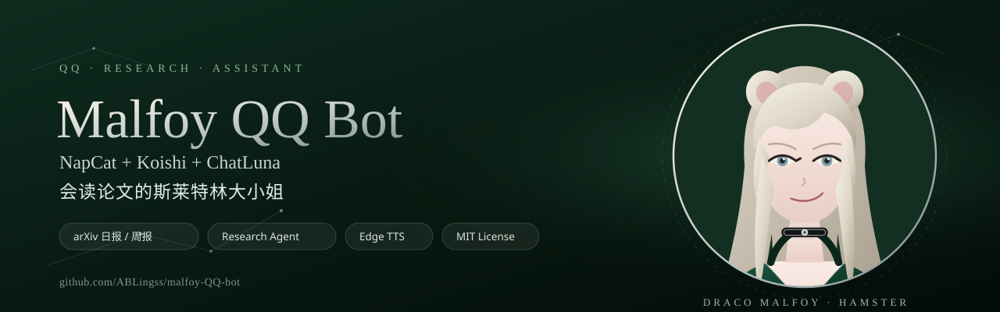

<p align="center">
  
</p>

<p align="center">
  <a href="https://github.com/ABLingss/malfoy-QQ-bot"></a>
  <a href="LICENSE"></a>
  <a href="https://github.com/ABLingss/malfoy-QQ-bot/actions/workflows/test.yml"></a>
  <a href="https://koishi.chat"></a>
  
  
  
</p>

<h1 align="center">Malfoy QQ Bot</h1>

<p align="center">
  A self-hosted QQ research assistant built on NapCat, Koishi and ChatLuna.<br>
  It tracks arXiv every day, ranks papers against your research profile, maintains a paper knowledge base,<br>
  and also handles chat, search, weather, translation, reminders, word games and voice replies.
</p>

<p align="center">
  <a href="README.md">简体中文</a> · <b>English</b>
</p>

<p align="center">
  
</p>

---

## Features

### Research

- **Daily arXiv digest**: scheduled collection, deduplication, rough ranking and structured analysis; delivers a Top 3 recommendation and a full Markdown report by private message.
- **Weekly research digest**: recent papers, trending terms, conference deadlines, weather, reminders and system status.
- **Personal research profile**: configurable directions, weights, priorities, project questions and score thresholds. Priority boosts affect ordering only and are never disguised as relevance.
- **Multi-dimensional scoring**: relevance, novelty, evidence confidence, reproduction value and recency. Abstract-only judgments are explicitly marked as preliminary.
- **Research knowledge base**: SQLite stores papers, abstract versions, analysis versions, tasks, usage, feedback and delivery records; notes are Obsidian-compatible.
- **Managed / user sections**: automatic updates only touch the managed block, so hand-written notes are never overwritten.
- **Paper commands**: search, summarize, deep analysis, compare, mark as read, mark for reproduction, feedback, research questions, task status, usage and cost.
- **Research question generation**: candidate questions, counterexamples, minimal experiments and uncertainty, with an explicit warning when evidence is insufficient.
- **Persistent task queue**: deep analysis, question generation and GitHub sync support task IDs, retries, restart recovery and completion notifications.
- **GitHub tool monitoring**: deduplicated release, pull-request and issue notifications. The first sync only establishes a baseline.
- **Deadlines and lineage**: CCFDDL deadline reminders and OpenAlex research-lineage queries.
- **Cost control**: hard daily and weekly budgets, token usage, cache hits, latency and estimated cost.

### QQ assistant

- **ChatLuna chat**: built-in general and Malfoy role presets, easy to extend.
- **Multimodal input**: send an image in private chat or mention the bot in a group; GIFs and memes are frame-sampled automatically.
- **Everyday tools**: DeepSeek web search, weather, translation and webpage summaries with SSRF protection.
- **Reminders**: scheduled reminders, list and cancel.
- **Wordle**: words, idioms, numbers and equations, with statistics and a leaderboard.
- **Meme mode**: a three-kingdoms-style roast easter egg.
- **Edge TTS voice**: read text directly with `念一下/朗读/语音：`; `说一说/讲一讲` answers first and appends a voice message.
- **Private and group chat**: group allowlist, mention triggers, rate limits and a separate research menu.

### Operations

- One-command config and secret setup; example configs contain no real accounts or research data.
- systemd unit templates; management ports bind to loopback only.
- Online SQLite backup, encrypted backup and a read-only restore drill.
- Status script, real-fetch + mock-LLM end-to-end dry run, migration script and unit tests.

---

## Quick start

```bash
git clone https://github.com/ABLingss/malfoy-QQ-bot.git
cd malfoy-QQ-bot

# 1. Create local config from the examples (existing config is preserved)
bash scripts/init-config.sh

# 2. Write API keys, bot QQ number and OneBot token
bash scripts/setup-secrets.sh

# 3. Install locked dependencies
cd koishi
npm ci
```

Then edit as needed:

- `config/arxiv.json` / `config/weekly.json`: digest schedules and delivery targets
- `config/bot.json`: group allowlist, feature switches, default city and persona
- `config/research-profile.json`: directions, weights, project questions, budgets and GitHub allowlist
- `config/tts.json`: Edge TTS voice, rate, limits and cache
- `koishi/koishi.yml`: copied from `koishi.example.yml`, local runtime config

Start Koishi, scan the QR code in the NapCat WebUI, and point the OneBot reverse WebSocket to
`ws://127.0.0.1:5140/onebot`. See [the deployment guide](docs/research-agent.md) and
[the configuration notes](config/README.md) for details.

> Runtime config, login state, databases, persona images and knowledge-base content are ignored by
> `.gitignore` and never enter the repository.

---

## Commands

Send commands directly in private chat; in groups you usually need to mention the bot.

| Area | Commands |
| --- | --- |
| Digests | `日报`, `研究.今日`, `周报` |
| Research menu | `研究`, `研究.菜单`, `研究.帮助` |
| Paper lookup | `研究.搜索 <keyword>`, `研究.总结 <arXiv ID>`, `研究.总结 <ID> 深度`, `研究.对比 <A> <B>` |
| Research management | `研究.已读 <ID>`, `研究.复现 <ID>`, `研究.反馈 <ID> <feedback>`, `研究.问题 <direction>` |
| Tasks and status | `研究.任务 [ID]`, `研究.同步`, `研究.状态`, `研究.缓存`, `研究.成本` |
| Deadlines and lineage | `ccf.今日`, `ccf.状态`, `脉络 <topic>` |
| Everyday tools | `搜索 <keyword>`, `天气 [city]`, `翻译 <text>`, `总结 <url>` |
| Reminders | `提醒 <delay> <text>`, `提醒列表`, `取消提醒 <index>` |
| Voice | `念一下 <text>`, `朗读 <text>`, `语音：<text>`, `说一说 <topic>` |
| Word game | `wordle`, `wordle.玩法介绍` |

See [the research agent docs](docs/research-agent.md) and
[the Wordle / meme notes](docs/wordle-and-xinsanguo.md) for more. The detailed docs are currently in Chinese.

---

## Tech stack

| Component | Purpose |
| --- | --- |
| [Koishi 4.18](https://koishi.chat) | Plugin-based bot framework and console |
| [NapCatQQ](https://github.com/NapNeko/NapCatQQ) + OneBot 11 | QQ protocol endpoint over reverse WebSocket |
| [ChatLuna](https://github.com/ChatLunaLab/chatluna) | LLM chat, presets and multimodal input |
| OpenCode Go | Default inference service; model is configurable |
| DeepSeek API | Optional, used by search and webpage-fetch tools |
| SQLite | Research database, sessions, tasks and usage |
| Edge TTS | Online speech synthesis; MP3 is converted to SILK automatically |
| arXiv / OpenAlex / CCFDDL / Open-Meteo / GitHub | Research, conference, weather and tool data |

```text
QQ client
   │
   ▼
NapCatQQ ──reverse WebSocket──> Koishi
                                 ├── ChatLuna ──> OpenCode Go / LLM
                                 ├── bot-services (search/weather/translate/summarize/reminders)
                                 ├── tts-voice (Edge TTS)
                                 ├── wordle-game
                                 └── arxiv-digest
                                       ├── arXiv / OpenAlex / CCFDDL
                                       ├── GitHub / Open-Meteo
                                       └── Research Agent v2
                                             ├── SQLite research DB
                                             ├── structured paper analysis
                                             ├── persistent task queue
                                             └── Markdown knowledge base
```

---

## Project layout

```text
.
├── assets/brand/          # original SVG brand assets (MIT)
├── config/                # example config and local config (local config is ignored)
├── docs/                  # research agent, weekly digest and Wordle docs
├── koishi/
│   ├── plugins/
│   │   ├── arxiv-digest/  # digests, CCFDDL, lineage, Research Agent
│   │   ├── bot-services/  # search, weather, translation, summaries, reminders
│   │   └── tts-voice/     # Edge TTS voice
│   └── koishi.example.yml
├── presets/               # ChatLuna preset examples
├── scripts/               # setup, secrets, backup, status, dry runs
├── systemd/               # service unit templates
├── tests/                 # unit tests
├── LICENSE
└── NOTICE
```

---

## Documentation

- [Research Agent architecture and operations](docs/research-agent.md)
- [arXiv daily / weekly digest configuration](docs/arxiv-weekly.md)
- [Wordle and meme mode](docs/wordle-and-xinsanguo.md)
- [Configuration reference](config/README.md)
- [ChatLuna presets](presets/README.md)

---

## Security

- The repository contains example configuration only. `.env`, `koishi.yml`, real research profiles, databases, login state and persona images are never committed.
- Management ports bind to `127.0.0.1` by default; use an SSH tunnel or port forwarding.
- Never send API keys, WebUI tokens, login QR codes, passwords or backups containing login state to chat, screenshots or public locations.
- NapCatQQ is an unofficial protocol implementation. Review QQ's terms and account risk before use; an alternate account is strongly recommended.
- This project is provided under the MIT License without any warranty of availability, compliance or account safety.

---

## License

Original code and the SVG assets under `assets/brand/` are released under the [MIT License](LICENSE).
Koishi, NapCatQQ, ChatLuna, QQNT, third-party plugins, character names and related material remain
under their own licenses and terms; see [NOTICE](NOTICE). The public repository does not include
persona images, knowledge-base content, real research profiles or production data.
